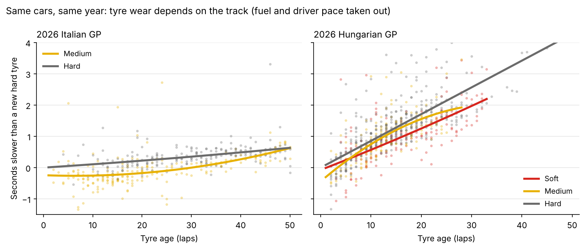
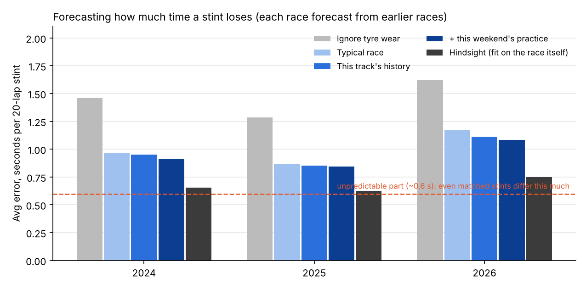
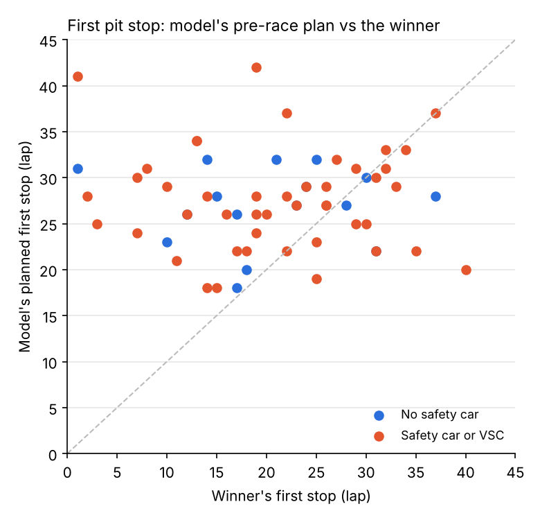

# F1 tyre degradation

**Result:** forecasting how much time a stint will lose to tyre wear, using only earlier races, gets within **0.97 s per 20-lap stint** on 1,635 stints from 2024 to November 2026, against 1.47 s if tyre wear is ignored. A pre-race pit plan built on those forecasts picks the right number of stops in 82% of dry races (judged against the best plan in hindsight). But it costs a median 9.5 s against that best plan, mostly because it trusts the soft tyre far more than teams do. This README explains why.

*Same cars, same season. At Monza the tyres lose about half a second over 50 laps; in Hungary they lose 2-3 seconds within 30. Each dot is a clean-air lap with fuel burn and the driver's pace taken out; lines are the fitted wear curves (compounds with fewer than 150 clean laps aren't drawn). In Hungary the compounds don't wear in the expected order. That's one of the model's weak spots, covered under Findings.*

Every lap of a race, the car gets lighter as fuel burns (faster) and its tyres wear (slower). Untangling the two tells you how fast each compound degrades at each track, and from that, when to pit and on which tyres. This project measures tyre wear lap by lap in every Grand Prix since 2019, tests whether it can be forecast before a race, and tests whether those forecasts lead to good pit strategies.

## The idea

**One equation per race.** Every clean lap is explained as:

> lap time = driver's pace that race + fuel effect × lap number + compound offset + wear(compound, tyre age)

Wear is a curve (linear plus a bend), fitted separately for soft, medium and hard.

**How fuel and wear are told apart.** Within a stint, tyre age and lap number go up together, one lap at a time, so the two effects can't be separated there. A pit stop resets tyre age while the lap count keeps going. Because drivers pit on different laps, each race contains enough of those resets to separate the two. (An automated test confirms that if every driver pitted on the same lap, the model could not tell them apart.) The fitted fuel effect comes out at **−0.06 s per lap** (median over races), which is in the physically expected range.

**Only laps that show real pace.** Left out:
- laps under safety car, virtual safety car or yellow flags
- lap 1, in-laps and out-laps
- wet tyres
- laps the timing system flags as inaccurate
- spins (more than 7% off the driver's typical lap)
- **laps in traffic**: any lap finished less than 2 s behind the car ahead, on that lap or the one before

The traffic filter matters. Without it the soft tyre looks slower than it is, because softs are mostly used at the start, when cars are queued behind each other. 191,778 laps go in; 79,024 clean-air laps are used.

**Pulling noisy estimates toward typical values.** A compound used for only a handful of laps can produce wild numbers, so each race's estimates are pulled toward what is typical, more strongly when there is less data.

## How it is tested

Everything is **walk-forward**: each race is forecast from races that happened before it, never from itself or later ones. An automated test checks this. Every setting (the traffic threshold, how strongly to pull toward typical, how much to trust a track's own history) was chosen on **2023** only. The numbers below are for **2024 to November 2026**, which played no part in those choices.

**Test 1, wear:** for each stint of 8+ clean laps, how much lap time did it actually gain or lose from start to finish, and how close was the forecast? The error is scaled to a 20-lap stint so it reads in seconds.

**Test 2, strategy:** for each dry race, take the fastest one- or two-stop plan under the pre-race forecast (using that track's typical pit-lane time loss, measured from earlier races). Then score it using the wear the race actually showed, against the best plan in hindsight.

## Findings (2024 to November 2026)

### Forecasting wear

| Forecast | Error, s per 20-lap stint |
|---|---:|
| Ignore tyre wear (fuel only) | 1.47 |
| Typical race | 1.00 |
| **This track's history** | **0.97** |
| Hindsight: fit on the race itself (not a forecast; the floor) | 0.68 |

- **Modelling wear is most of the gain.** Ignoring it misses by half a second more per stint.
- **Track history helped clearly in 2023** (0.78 vs 0.93 s for a typical race) **but only marginally in 2024-26** (0.97 vs 1.00). Race by race, the difference isn't distinguishable from zero (95% interval −0.07 to +0.07 s). Conditions on the day (temperature, which compounds Pirelli brings, track surface changes) matter more than the track's past.
- **Even hindsight misses by 0.68 s.** That's the floor: drivers manage their pace and fight traffic in ways no lap-time model captures.
- **Softs are hardest** (1.45 s error vs 0.81 s for hards). They're used least and in the shortest stints, so their wear is measured worst.
- **2026 is the worst year** (1.11 s). New cars and tyres arrived, and history from the old cars fits them less well.
- **Watching the race doesn't help.** Re-fitting wear on the first 40% of the race made forecasts for later stints worse (0.94 vs 0.79 s, tested on 2023). Early laps run on heavy fuel, a green track and managed pace, and they mislead about later stints.

### Pit strategy (61 dry races)

| | |
|---|---:|
| Pre-race plan uses the same number of stops as the best plan in hindsight | 82% |
| ... as the race winner | 64% |
| Best plan in hindsight uses the same number of stops as the winner | 66% |
| Time the pre-race plan loses vs the best plan in hindsight (median) | 9.5 s |
| Pre-race plans that start on softs / winners that started on softs | 72% / 15% |

- **Number of stops: nearly as good as it gets with this approach.** The pre-race plan agrees with the winner about as often as the hindsight-best plan does (64% vs 66%). The remaining disagreement comes from things lap times don't show: track position, undercuts, safety cars.
- **Tyre choice is the weak spot.** The model starts most races on softs; winners almost never do. In race trim, new softs, mediums and hards come out within about a tenth of a second of each other in this data, not even in the expected order. So the model rarely sees a reason to avoid the soft's faster wear, while teams know softs also grain, overheat and fall off a cliff. Those effects show up as lost track position, not in clean-air lap times. This is the main reason a plan that gets the number of stops right still loses 9.5 s.
- **Safety cars.** 45 of the 61 dry races had a safety car or VSC. In those, the winner stopped twice or more 49% of the time, against 31% without one. A stop under a safety car costs about half as much, and this model doesn't account for that. (In 2023 the difference didn't appear, so treat it as suggestive.)

## What would make it better

1. **Model the soft tyre's cliff and graining.** Use stint-end behaviour (how long stints *could* have gone) rather than average wear only.
2. **Safety cars in the strategy:** simulate races with random safety cars drawn from each track's history, and pick the plan that is best on average rather than in a clean race.
3. **Track temperature and compound allocation** (C1 to C5) as inputs to the wear forecast.

## Run it

In PyCharm, open each file and click the green ▶ arrow:

1. `step1_setup.py`: one time, creates `.venv` and installs packages
2. `step2_run_analysis.py`: downloads the lap data (first time about 60 MB from GitHub), fits every race, runs both tests, writes `output/` and the charts (about 3 minutes)
3. `step3_run_tests.py`: the automatic checks

Or from a terminal: `python run.py`.

## Files

| | |
|---|---|
| `tyres/data.py` | download, tidy, gap to the car ahead, clean-lap filter |
| `tyres/model.py` | the per-race lap-time model (fuel, compound offset, wear) |
| `tyres/forecast.py` | forecasting wear from earlier races, and the stint test |
| `tyres/strategy.py` | pit-lane time loss, plan search, and the strategy test |
| `tyres/report.py` | charts |
| `output/` | wear for every race, every stint forecast, every race's plans, `summary.json` |

## Data

Lap-by-lap timing (lap times, tyre compound and age, stints, pit flags, track status, track temperature) 2019-2026 from [TracingInsights](https://github.com/TracingInsights), which archives the official F1 live-timing feed via FastF1. This project is unofficial and not associated with Formula 1 or Pirelli.
